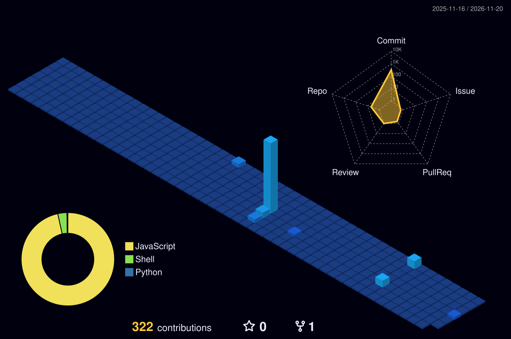

  

  

  

  

  

  

## ⚔️ Mission Archive

| Mission | What it is | Stack |
|---|---|---|
| [**Sotunol API**](https://github.com/dhia-ui/Sotunol-API-) | FastAPI microservices for an industrial client | `Python` `FastAPI` `PostgreSQL` |
| [**Sotunol Enterprise**](https://github.com/dhia-ui/sotunol_enterprise_5189) | Production web platform with AI document processing | `React` `Tailwind` |
| [**Train Model**](https://github.com/dhia-ui/Train-Model) · [**End-points IA**](https://github.com/dhia-ui/End-points-IA) | Training and serving the cheque / document / invoice models | `Python` `EasyOCR` |
| [**PFE**](https://github.com/dhia-ui/PFE) | Final-year project: API security audit and hardening | `Flask` `Docker` `Burp` |
| [**Radio ISTIC**](https://github.com/dhia-ui/radio-istic) | Member portal for the ISTIC radio community | `Next.js` `Node.js` `MongoDB` |
| [**Portfolio**](https://github.com/dhia-ui/dhia-portfolio-) | Interactive personal portfolio | `React` `Three.js` |

<a href="https://github.com/dhia-ui?tab=repositories"><b>→ See all repositories</b></a>

  

### 🌃 My contribution village

*Every commit raises another building — rebuilt automatically every day.*

 

  

  

  

**Security is a process — keep building, keep hardening.** 🔥

